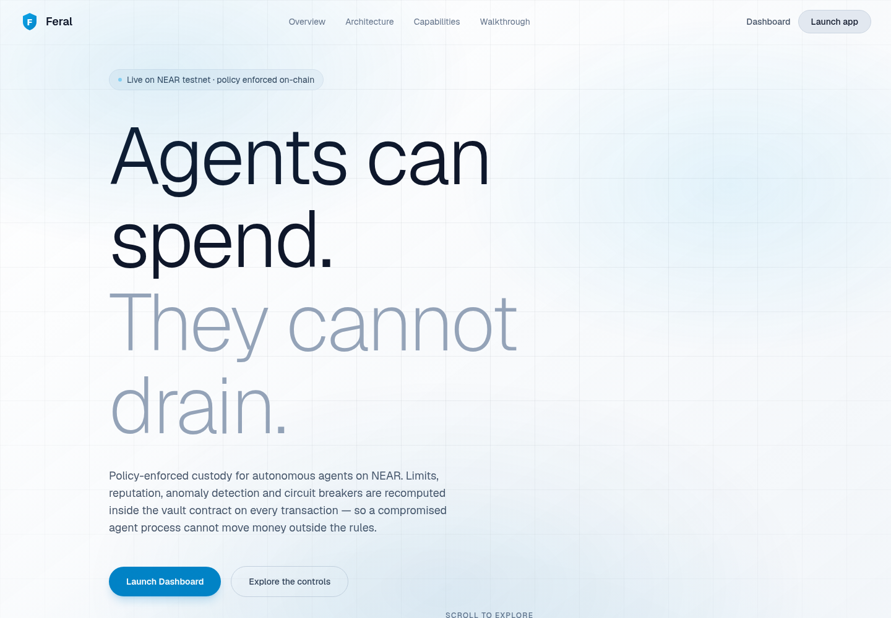
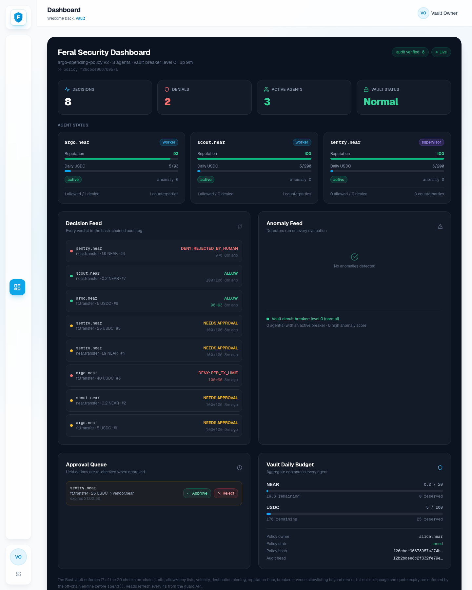

# Feral

**Policy-enforced custody for autonomous agents on NEAR: the agent gets a key
that can only call `spend()`, and the contract holding the money recomputes
every limit from its own storage before a single unit moves.**

**Three proof points**

- **17 checks enforced on-chain.** Per-transaction, daily, monthly and
  cross-agent limits, allow/deny lists, destination pinning, velocity,
  reputation, anomaly state and circuit breakers run in the Rust vault. The
  off-chain engine mirrors 20 checks for previews and tests; it cannot move
  funds.
- **A refusal is not free.** A denied `spend` returns `allowed:false`, emits a
  NEP-297 `deny` event with the reason code, moves no funds, and immediately
  records a reputation and anomaly penalty. On testnet a 1.5 NEAR attempt
  against a 1 NEAR cap took reputation from 100 to 90.
- **Auditable end to end.** 151 JavaScript tests (150 pass, one network-gated
  skip), 60 Rust tests, 52 adversarial scenarios, 37/37 checks against the live
  contract, and a hash-chained decision log. Re-run all of it offline with one
  command.

```bash
npm run demo:judge     # the full allow / deny / approval / audit story in 60s
```

**[Watch the 2:42 narrated walkthrough](docs/feral-demo.mp4)** — the live testnet
denial, reputation penalty, dashboard, governance and audit chain.

**Live testnet vault:** `aa0cfa9951c95da04c563952ca56c79d078e10fb73c8987e66bed2d4202d38fb`
([account](https://testnet.nearblocks.io/account/aa0cfa9951c95da04c563952ca56c79d078e10fb73c8987e66bed2d4202d38fb) ·
[redeploy](https://testnet.nearblocks.io/txns/yhsp8BZnczRzyWUn4CxfaKyMbjPizE9BJ6G5x2GL43V) ·
[denied spend](https://testnet.nearblocks.io/txns/B7i3Q1Yx8qA84yTpfpmbyDLYaM3Li5HZwF49JdQRqxtU))

Built for **NEAR HACKATHON** — **AI Security & Defense** track.

```
agent ──► intent ──► [ Feral on-chain engine ] ──► allow ──► funds move
                            │  deny ───────────► nothing moves, reason + reputation update
                            └─ require_approval ─► human co-signs, re-checked at execution
```

### The product





The dashboard is a real client of the guard: agent reputation, effective limits,
the decision feed, anomaly flags and the approval queue all come from
`/api/summary`, and approving or rejecting calls the same `FeralGuard` methods as
the CLI.


---

### Try it in 60 seconds, no wallet needed

Requirements: **Node.js >= 22.6**. Native TypeScript execution, no build step,
zero dependencies for the default path.

```bash
npm run demo:judge  # 60 seconds: 10 scenes, 3 agents, zero config, no wallet
npm run test:all    # 151 tests, 0 failures, 1 network-gated skip
npm run attack      # 52 adversarial scenarios, every verdict asserted
npm run verify      # 1000 random actions, all invariants asserted
npm run serve       # dependency-free console on http://127.0.0.1:8787
```

### Dashboard frontend

The Next.js app in `dashboard/` is the product UI. It proxies `/api/*` to the
guard, so both processes run together:

```bash
npm run serve        # guard + JSON API on :8787
npm run dashboard    # Next dev server on :3000
```

For a production build:

```bash
npm run dashboard:build && npm run dashboard:start
```

Set `FERAL_API_URL` if the guard is not on `http://127.0.0.1:8787`. The frontend
has no policy logic of its own: it renders guard state and posts approve/reject.

---

### What makes Feral different

Earlier spending firewalls stop simple overspending. They check transactions against
static rules before they move. If the checking process is compromised, only
basic on-chain limits hold.

Feral moves the money-moving checks on-chain, adds adaptive reputation, detects
anomalies in real-time, supports multiple agents under one vault, and provides
governance for recovery.

| | A spending firewall | Feral |
|---|---|---|
| Where enforcement happens | off-chain process + basic on-chain | limits, reputation, anomaly and destination pinning on-chain; quote checks off-chain |
| Agent identity | function-call key | registered attestation hash + function-call key |
| Limits | static YAML | adaptive, reputation-adjusted, on-chain |
| Agents | one | many, with aggregate + coordination security |
| Threat detection | static rules | statistical anomaly detection on-chain |
| Response to attacks | manual pause | 4-level automatic circuit breakers |
| Owner governance | absolute, instant | timelocked + watcher cancellation + multisig |
| Audit | local hash chain | hash chain + on-chain anchoring |

### The 20 checks

Every `spend()` call runs these in order. The contract enforces the
irreversible ones; the quote-level checks run in the pure engine before
submission, because the contract only sees the final transfer:

1. Vault emergency freeze check
2. Vault circuit breaker check (level 3)
3. Agent circuit breaker check (level 2)
4. Agent paused check
5. Attestation-proof verification (hash commitment; if registered)
6. Amount is positive and valid
7. Action kind allow/deny list
8. Per-tx limit (reputation-adjusted)
9. Rolling daily limit (reputation-adjusted)
10. Rolling monthly limit (reputation-adjusted)
11. Aggregate vault limit (across all agents)
12. Counterparty deny list
13. Counterparty allow list (strict mode)
14. Velocity: burst window (5 tx / 60s)
15. Velocity: min interval between txs
16. Intent venue allowlist (contract allows only near-intents; the full list is checked off-chain)
17. Slippage ceiling (off-chain)
18. Quote expiry (off-chain)
19. Destination address pinning (cross-chain)
20. Reputation floor (reputation > 0)

The engine mirrors these checks before submission; the contract independently
recomputes the on-chain ones from its own storage. Checks 17-18 cannot run
on-chain because `spend()` never sees the quote.

### Adaptive reputation

Every agent starts at reputation 100. The contract updates it on every call:

- Clean spend within policy: +1 (capped at 100)
- Denial: -10 (floored at 0)
- Approval completed: +2 (agent escalated correctly)
- Anomaly flag: -15

Effective limit = `base_limit * (reputation / 100)`. An agent at reputation 40
only gets 40% of its daily cap. At reputation 0, the agent is frozen.

Reputation recovers: a 30-day clean window restores 20 points.

### On-chain anomaly detection

- **Burst detection**: > 5 transactions in 60 seconds triggers circuit
  breaker level 1 (limits reduced to 10% for 1 hour)
- **Drainage detection**: > 50% of daily limit to one address triggers flag
- **Deviation detection**: transaction 5σ above behavioral baseline triggers flag
- **Auto-escalation**: high anomaly score → circuit breaker or reputation penalty

### 4-level circuit breakers

| Level | Trigger | Effect | Duration |
|---|---|---|---|
| 0 | Normal | — | — |
| 1 | Anomaly detected | Agent limits reduced to 10% | 1 hour, auto-expire |
| 2 | Multiple anomalies | Agent paused | Owner reactivation |
| 3 | Aggregate anomaly | Vault paused | Owner + watcher quorum |
| 4 | Emergency | All spending frozen | Timelocked thaw |

Any guardian can trigger level 4. Only the owner can thaw.

### Multi-agent coordination security

One vault, many agents:

- Each agent has individual limits, reputation, and state
- The vault has aggregate limits that no combination of agents can exceed
- Pausing one agent doesn't affect others
- Aggregate caps still apply when several agents spend concurrently

### Governance

- **Timelocked admin actions**: `withdraw`, `set_policy`, `set_agent` enter a
  1-hour timelock. During the timelock, designated watchers can cancel.
- **Watcher cancellation**: external monitoring services registered as watchers can
  cancel any timelocked action.
- **Guardian freeze**: any guardian can trigger an emergency freeze (level 4).
- **Multisig owner**: admin actions can require M-of-N signatures.

### Attestation

The contract stores an expected attestation-proof hash for each agent. Every
`spend` call can include a proof; the contract hashes it and compares. A
stolen key without the registered proof cannot spend. This is a hash
commitment, not a remote TDX/SGX report; see
[THREAT_MODEL.md](THREAT_MODEL.md) for the residual risk.

---

### Repository layout

```
src/core/          money, policy DSL, ledger, audit, the pure engine, reputation, anomaly, circuit breakers
src/core/engine.ts mirror of on-chain evaluate(), 20 checks, no I/O
src/core/service.ts FeralGuard: multi-agent, approvals, reputation, governance, simulation
src/core/reputation.ts reputation calculation
src/core/anomaly.ts anomaly detection
src/core/circuit.ts circuit breaker state machine
src/chain/         NEAR Intents (1Click) client, chain signatures (MPC) helper
src/integrations/  GatedToolbox (paid tool calls) + loop.ts (agent retry logic)
src/demo/          the 50+ scenario catalogue shared by CLI, dashboard, tests
src/cli/           feral demo | demo:judge | attack | verify | bench | serve | audit | quote | chainsig | simulate | reputation | anomaly
src/app/           dependency-free HTTP server + built-in dashboard (no build step)
dashboard/         Next.js product dashboard, reads the guard API through /api
examples/          the policy a human writes + example actions
contract/          Rust vault (near-sdk), full on-chain enforcement, 60 tests
test/unit/         150+ tests: money, YAML, policy, engine, reputation, anomaly, circuit, governance
test/adversarial/  50+ scenario assertions, property-based testing, formal verification
scripts/           testnet accounts/demo, benchmarks, conformance
docs/              threat model, testnet evidence, demo script, FAQ
data/fixtures/     one recorded live 1Click quote (offline reproducibility)
```

---

### The contract

```bash
cd contract
./build.sh              # builds res/feral_vault.wasm
./test.sh               # 60 unit tests (needs a host C toolchain for cargo test)
```

---

### Hackathon focus

One track: **AI Security & Defense**. Multi-agent limits, reputation and
approvals are supporting features of that security story, not separate
submissions.

### What is not implemented

- **Hardware attestation.** The contract checks a registered proof hash; it does
  not verify a TDX/SGX quote or bind a key to an enclave.
- **MPC signing execution.** `src/chain/chainsig.ts` derives addresses and builds
  payloads for chain signatures, but the live vault does not yet sign transfers
  through MPC.
- **Mainnet deployment.** All evidence is NEAR testnet; no mainnet vault exists.
- **Hosted product.** The Next dashboard runs locally, has no user accounts,
  auth or tenant isolation, and is not deployed as a service.
- **Production price oracle.** Native NEAR limits are exact; non-NEAR pricing is
  injected and has no signed production feed.
- **Global reputation.** Reputation is per registered agent inside one vault;
  there is no cross-vault identity or sybil resistance.
- **Clustering detection.** Multiple agents paying the same address is not
  correlated on-chain; aggregate caps still bind them.
- **Bridge execution.** Cross-chain destination pinning is checked, but Feral
  does not execute or verify the bridge leg.

---

### Security policy

See [SECURITY.md](SECURITY.md). The threat model with the reasoning behind
each guarantee is in [THREAT_MODEL.md](THREAT_MODEL.md).

### Licence

MIT. Built at NEAR HACKATHON, November 2026.
