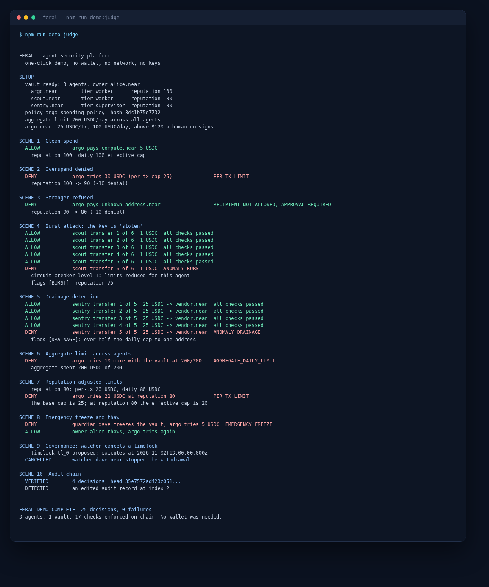
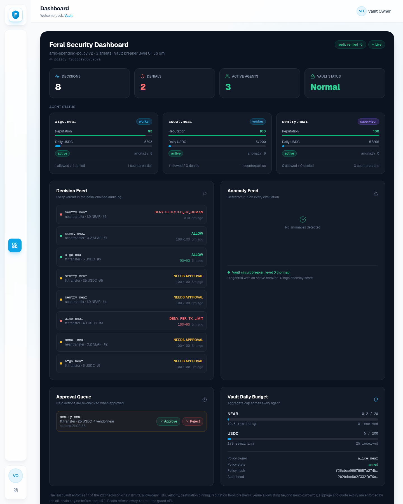

# Feral demo

## Narrated walkthrough

**[Watch the 2:42 demo](feral-demo.mp4)** — live testnet denial, reputation
penalty, dashboard, governance and audit. The audio is synthesized; every hash
shown is from the real transactions recorded in [TESTNET.md](TESTNET.md).

## Zero-configuration path

```bash
npm run demo:judge  # about 60 seconds, no wallet, no keys, no network
npm run attack      # 52 adversarial scenarios, every verdict asserted
npm run verify      # 1000 random actions, invariants checked after each
npm run serve       # dashboard on http://127.0.0.1:8787
```



`demo:judge` builds a three-agent vault in memory, runs ten scenes and exits 1 if
any scene produces a different verdict than advertised. It needs Node.js >= 22.6
and nothing else. The scenes are: a clean spend, an overspend, a stranger, a
burst, drainage, the aggregate cap, reputation-adjusted limits, an emergency
freeze and thaw, a watcher cancelling a timelock, and the audit chain (including
detecting a hand-edited record).

## Full narrative

```bash
npm run demo
```

Runs the judge scenes, then adds a recorded NEAR Intents quote (allowed at the
pinned destination, refused when redirected), a policy simulation against the
decisions just made, and a final audit verification.

## Dashboard

There are two frontends over the same guard.

`npm run serve` serves a dependency-free console on `http://127.0.0.1:8787`:

- agent cards: reputation, tier, status, effective limits, anomaly score, breaker
- aggregate daily and monthly budgets across all agents
- the approval queue with approve/reject
- governance: pending timelocks, emergency freeze, thaw
- an anomaly feed and the full decision feed with reputation before/after
- a policy simulation box

The built-in page polls `/api/summary` every few seconds. Every action button
calls the same `FeralGuard` methods as the CLI; there is no second policy path.

The Next.js app in `dashboard/` is the product UI:

```bash
npm run serve        # terminal 1: guard + API on :8787
npm run dashboard    # terminal 2: Next app on :3000
```



It renders real guard state only: agents and effective limits, the hash-chained
decision feed, anomaly flags, aggregate vault budgets, policy and audit heads,
and the approval queue. `/api/*` is rewritten to `FERAL_API_URL` (default
`http://127.0.0.1:8787`), so the browser never needs CORS. Without the guard it
shows an explicit "could not reach the guard" state instead of fake data.

## Benchmarks

```bash
npm run bench
```

Both print p50/p95/p99/max microseconds for the check shapes (allow, overspend,
stranger, denied kind, aggregate, anomaly, breaker).

## Deterministic replay

```bash
npm run verify -- 12345
```

The seed drives a mulberry32 PRNG, so a failing run is reproducible. Invariants:
no denial moves the aggregate ledger, no allow pays a stranger, the aggregate cap
is never exceeded, replay is always refused, reputation and anomaly scores stay
in 0-100.

## Live chain commands

```bash
feral quote       # live 1Click quote, gated by the destination and slippage policy
feral chainsig    # derives the MPC address and compares it with the pinned one
```

Both are optional. Without network access the quote command uses
`data/fixtures/quote.json`; `chainsig` explains the failure and exits 1.
